# Omarkd

A lightweight Tauri 2 Markdown reader and editor, built with Bun, Rust, and plain TypeScript.

## Features

These screenshots are generated by the passing [reader](e2e/features.spec.ts) and
[editor](e2e/editor.spec.ts) Playwright feature tests.
They show the real reader UI and Rust-rendered documents in a browser with a
controlled native bridge, not the macOS window frame or native file dialog.

### Beautiful Markdown

CommonMark and GitHub-flavored Markdown with tables, task lists, alerts, emoji,
footnotes, description lists, superscript, wiki links, and hidden front matter.

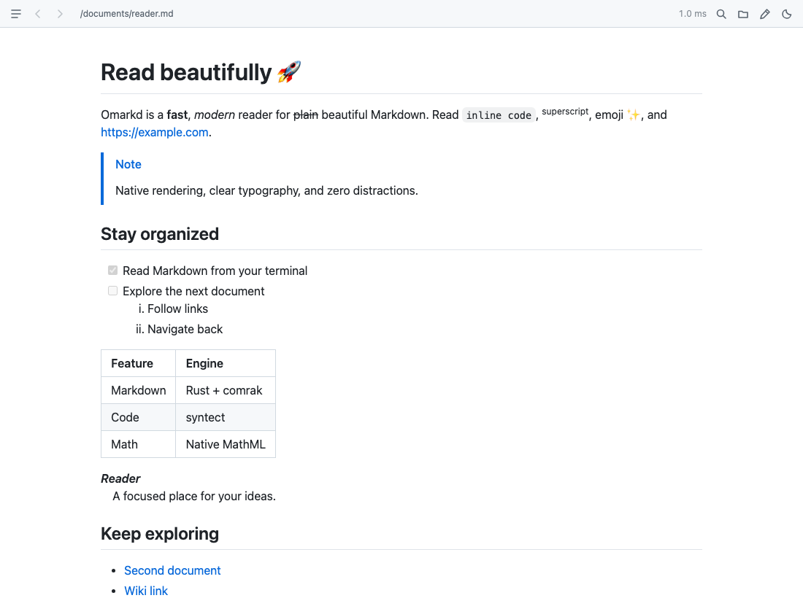

### Open from your terminal or toolbar

Launch with `omarkd README.md`, open files from the toolbar, or drag Markdown
documents into the reader. Multiple files open in separate document windows.

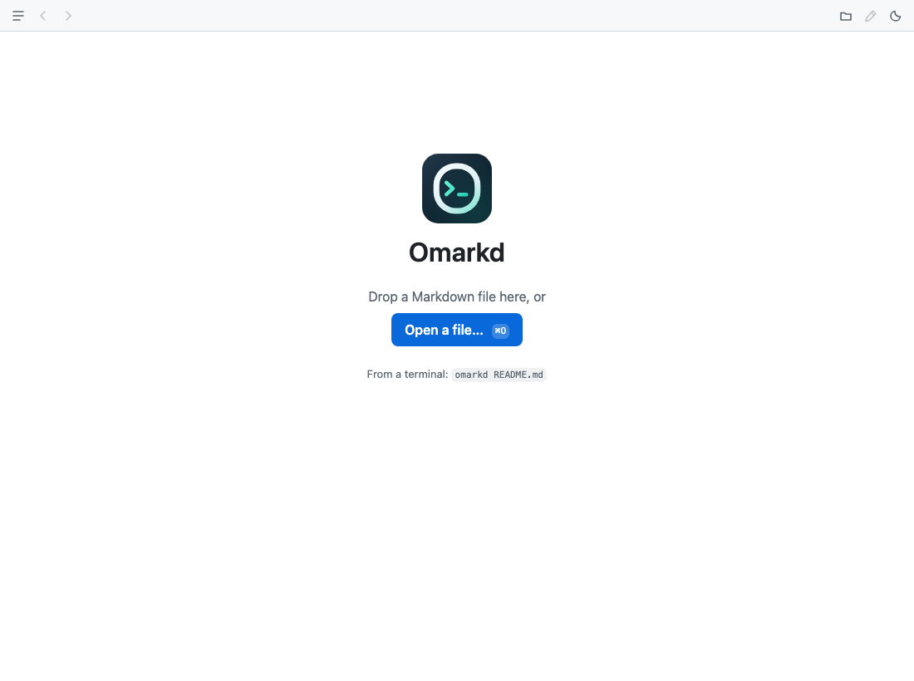

See the tested [open-file flow](assets/screenshots/open-files.png) and
[drag-and-drop result](assets/screenshots/drag-and-drop.png). Browser tests verify
the native API calls; OS dialogs and actual window creation need the native smoke
checks described below.

### Highlighted code, ready to copy

Native Rust, TypeScript, JavaScript, and Python highlighting, plus a copy button
on code blocks. Unknown languages remain readable.

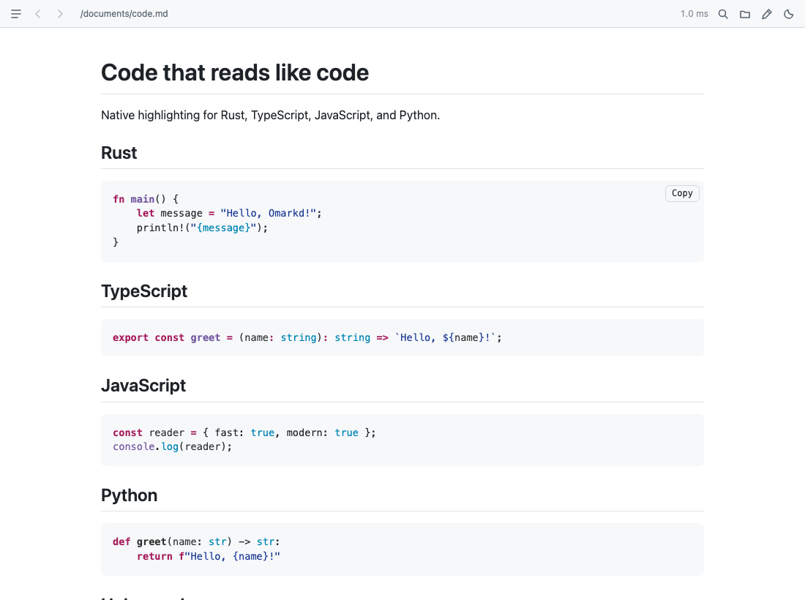

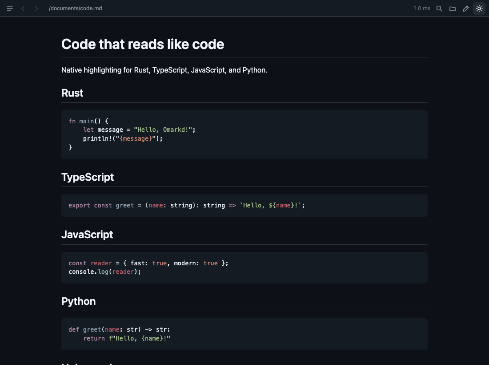

### Equations and diagrams

Inline, display, and fenced math becomes native MathML. Mermaid diagrams render
locally and load only when needed.

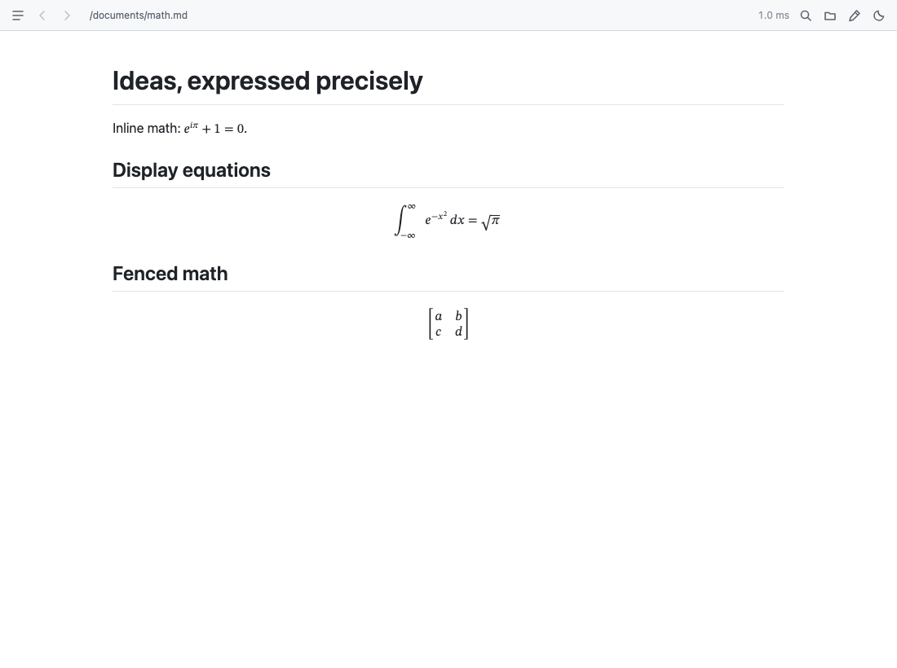

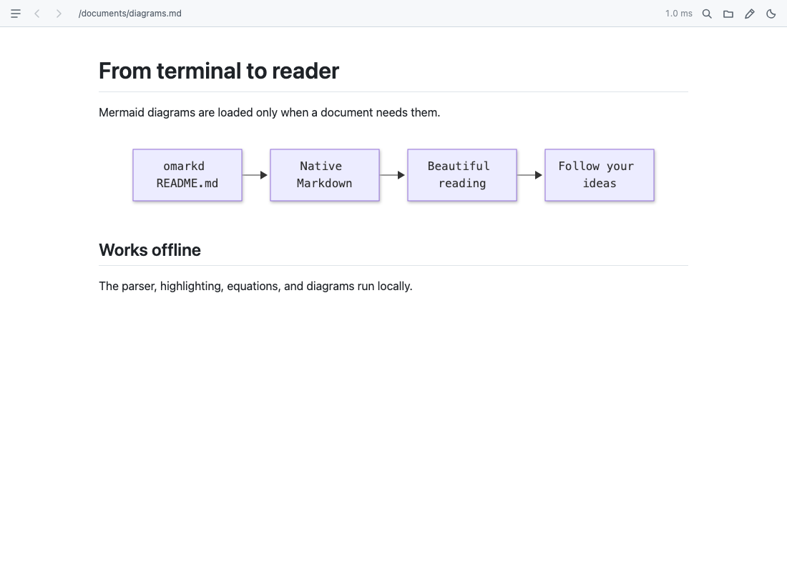

### Navigate and find

Jump through the heading outline, follow document links, navigate back and
forward, and find text with keyboard shortcuts.

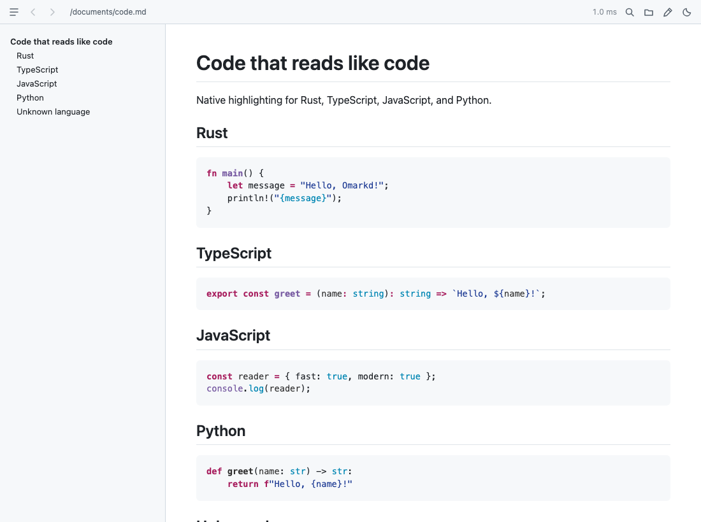

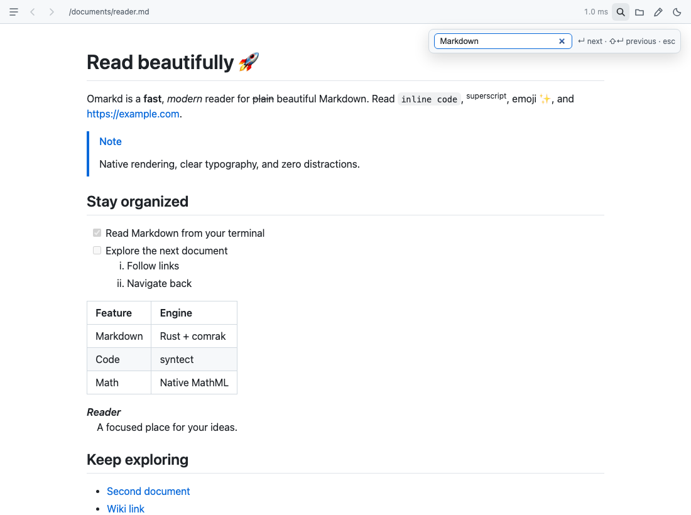

See [document navigation](assets/screenshots/document-navigation.png) and
[external links, attachment opening, and path reveal](assets/screenshots/desktop-link-actions.png).

### Light and dark, your way

Use the top-right sun/moon toggle. Your choice persists across launches and
document windows, with matching code and diagram colors. Until you choose a
theme, Omarkd follows the operating system.

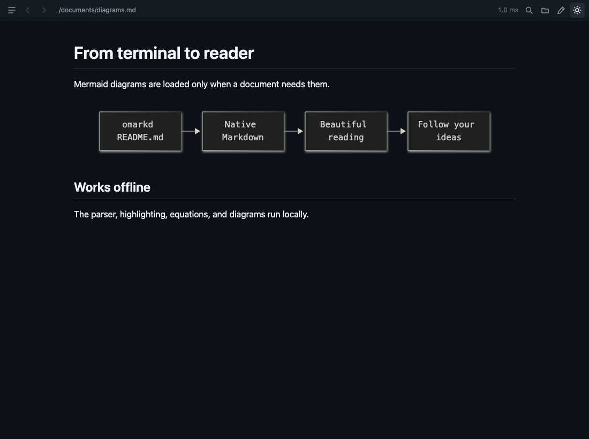

The [system-theme test](assets/screenshots/system-theme.png) verifies automatic
theme changes without creating a manual preference.

### Edit Markdown with automatic saving

Click the pencil toggle near the top-right corner to switch between reading and
editing. The lightweight CodeMirror text editor provides Markdown syntax colors,
line numbers, soft wrapping, undo/redo, and find, with matching light/dark themes.
Editor code loads only when you enter edit mode.

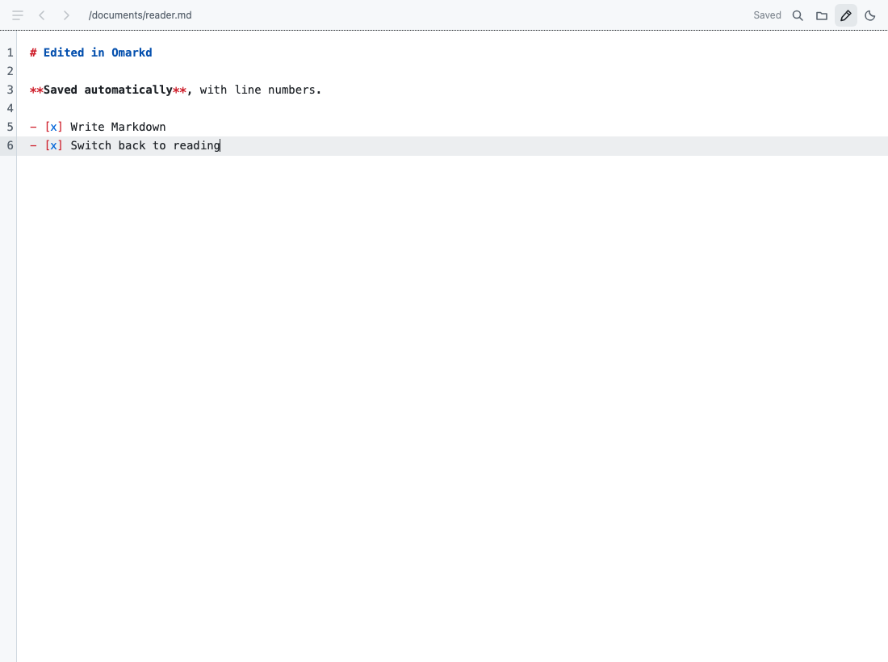

Changes save automatically after a 300 ms pause. Saves run in order and include
edits made during an earlier save. Switching to View, navigating to another
document, closing the window, or quitting waits for saving to complete. View mode
then renders the saved Markdown; **Cmd/Ctrl+S** also saves immediately.

If saving fails, your text stays in the editor and leaving is blocked. Retry
after fixing the problem, or copy your draft. If another app changes the file,
Omarkd pauses autosave instead of silently overwriting it. Explicitly choose
**Overwrite disk with my edits** or **Discard edits and reload disk**.
Clean external changes reload into the editor automatically.

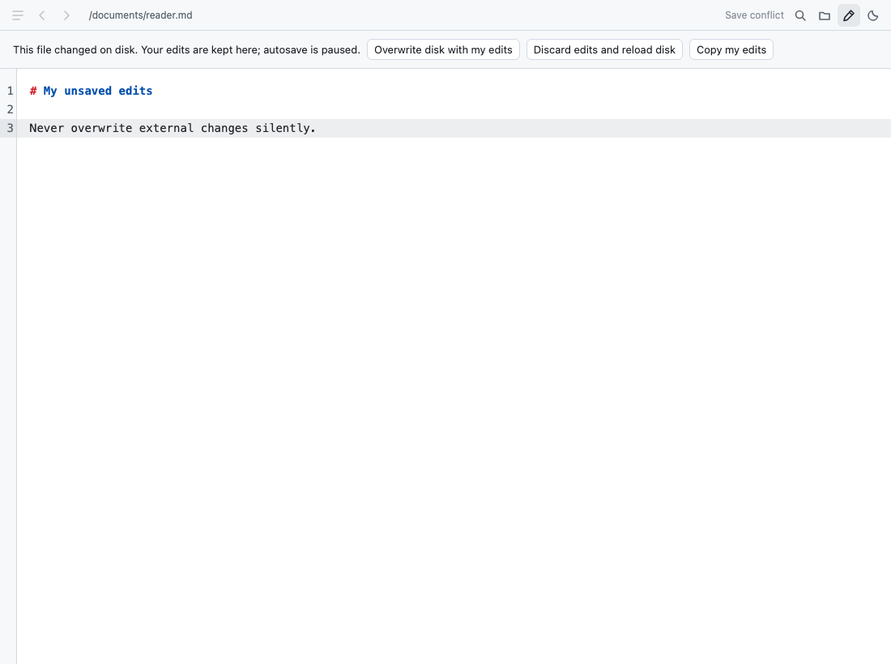

Editable files must be valid UTF-8. Saves preserve a UTF-8 BOM, the selected LF or
CRLF line-ending convention, and file permissions, using a temporary file in the
same directory and atomic replacement. Mixed line endings are normalized to the
document's initial convention when edited. Replacement does not guarantee preservation
of extended filesystem metadata or hard-link identity. Disk contents are checked
before replacement, but unrelated programs do not participate in Omarkd's save
lock, so a last-instant external write can still race with replacement.
Unsaved drafts are kept in the current window, not recovered after a crash.

| Editor behavior | Screenshot |
| --- | --- |
| Retained draft and retry after a write error | [Save recovery](assets/screenshots/editor-save-failure-and-retry.png) |
| Returning to View waits for saving | [Save before View](assets/screenshots/editor-view-waits-for-pending-save.png) |
| Reloading disk after an explicit discard | [External reload](assets/screenshots/editor-external-reload-and-discard.png) |
| Matching theme and editor search | [Dark editor search](assets/screenshots/editor-theme-and-find.png) |
| Ordered saves and undo/redo | [Serialized saves](assets/screenshots/editor-undo-and-serialized-saves.png) |
| Save before opening another file | [Navigation guard](assets/screenshots/editor-navigation-save-guard.png) |
| Quit acknowledgment only after saving | [Quit guard](assets/screenshots/editor-quit-save-guard.png) |
| Wrapping and controls at minimum width | [Compact editor](assets/screenshots/editor-compact-window.png) |

### Rich content in compact windows

Read expandable HTML, native MathML, and document-relative images. Embedded
scripts, frames, event handlers, and active URLs are stripped.

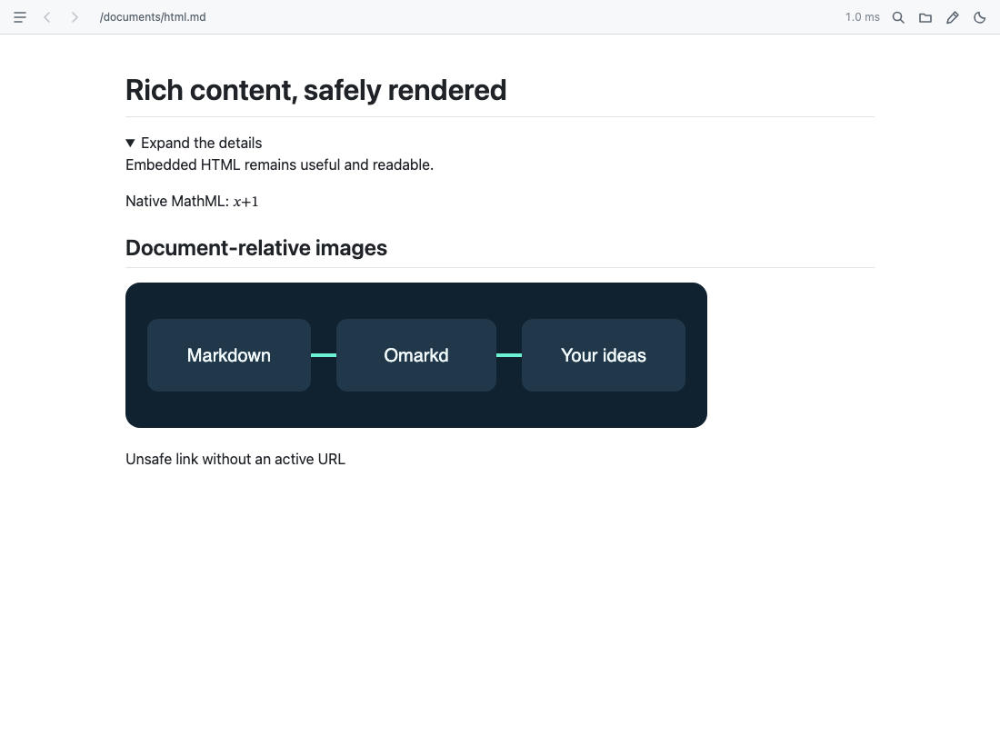

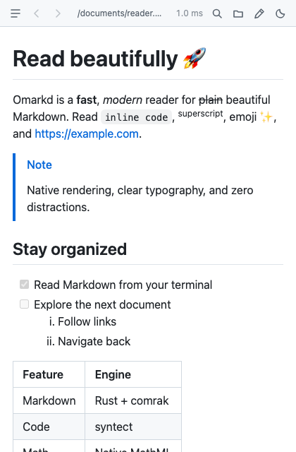

### Reliable updates and clear diagnostics

Saving a document reloads it without losing your scroll position. Rapid changes
are debounced, stale loads cannot replace newer documents, and file or watcher
errors are shown explicitly.

| Tested behavior | Screenshot |
| --- | --- |
| Manual and live reload with preserved scroll | [Live reload](assets/screenshots/live-reload.png) |
| Unreadable or missing documents | [Document error](assets/screenshots/errors.png) |
| Watcher failure without losing the document | [Watcher error](assets/screenshots/watch-errors.png) |
| Latest document wins overlapping requests | [Concurrent loads](assets/screenshots/latest-document-wins.png) |
| No math or diagram module requests for ordinary documents | [Lazy rendering](assets/screenshots/lazy-loading.png) |

## Run

Requires Bun, Rust, and the [Tauri platform prerequisites](https://v2.tauri.app/start/prerequisites/).

```sh
bun install
bun run app:dev -- examples/showcase.md
```

Build the desktop app:

```sh
bun run app:build
```

On macOS the app is produced at `src-tauri/target/release/bundle/macos/Omarkd.app`.
Copy it to `/Applications` if desired. The default bundle targets are macOS app
and DMG; use `bun tauri build --bundles deb` on Linux or `--bundles nsis` on Windows
with the respective platform prerequisites installed.

## App icon

The icon combines an O monogram with a terminal prompt in mint and midnight blue.
The editable vector source is [icon.svg](icon.svg), also used by the welcome screen
and browser favicon. Desktop icon assets live in [src-tauri/icons](src-tauri/icons).
After editing the source, regenerate the platform icons with:

```sh
bun run app:icons
```

## Command-line launcher

```sh
bun run install:cli
omarkd README.md
omarkd docs/guide.markdown
omarkd one.md two.md
omarkd .                       # opens the directory's README
```

The installer previews the source launcher, destination, replacement of an
existing command, and PATH requirements, then asks for confirmation before making
any changes. With [Gum](https://github.com/charmbracelet/gum) installed, a menu offers
`~/.local/bin`, `/usr/local/bin`, or a custom directory, followed by a confirmation
dialog that defaults to No. Without Gum, it selects `/usr/local/bin` if writable
or `~/.local/bin` otherwise, prints the plan, and asks for a typed confirmation.
Answer `y` or `yes` to proceed; declining or ending input makes no changes.
It does not use sudo or modify your shell configuration.

Pass a custom location to skip the destination menu (confirmation still applies):

```sh
sh scripts/install-cli.sh "$HOME/bin"
```

Uninstall the command with `npm run uninstall:cli` (or `bun run uninstall:cli`).
The uninstaller detects launcher symlinks for this checkout in PATH,
`~/.local/bin`, and `/usr/local/bin`, previews all detected links, and asks for
confirmation with Gum when available or a typed `y/yes` otherwise. Both default
to No; cancellation or EOF makes no changes. It removes only those symlinks,
keeping the app, checkout, documents, directories, and shell configuration.
Regular files and launcher links to other checkouts are not removed.
For a custom installation outside PATH, specify the directory:

```sh
npm run uninstall:cli -- "$HOME/bin"
```

You can also use `./bin/omarkd examples/showcase.md` without installing.
The POSIX launcher searches installed macOS apps and the local release build.
Set `OMARKD_BIN` to use a particular executable. On Windows, invoke the built
`omarkd.exe` directly with file paths.

Each file opens in its own window. Subsequent invocations reuse the running app;
opening an already-open file focuses its window. macOS also supports Finder's
**Open With** through registered Markdown file associations. On macOS, the app
stays resident after closing its windows; use **Quit** to exit.

## Rendering

- CommonMark and GitHub-flavored Markdown: tables, task lists, strikethrough,
  autolinks, heading anchors, and alerts.
- Native syntax highlighting through syntect and the extended two-face syntax set,
  including Rust, TypeScript, JavaScript, Python, and many others.
- Inline `$...$`, display `$$...$$`, and fenced `math` expressions, rendered by
  Temml into native MathML.
- Emoji shortcodes such as `:rocket:` and `:+1:`.
- Mermaid diagrams, loaded only when a document contains them.
- Footnotes, description lists, superscript, wiki links, and hidden YAML front matter.
- Embedded HTML such as `<details>` and native MathML, with active elements and
  event handlers removed before insertion.
- Relative Markdown links navigate within the window; external URLs open in the
  system browser. Relative Markdown image paths resolve against the file directory.

This is not an MDX/JavaScript runtime. Unknown code languages
remain readable as plain code. Raw HTML local image URLs are not rewritten;
use Markdown image syntax for document-relative images. Remote images require a
network connection; the parser, highlighting, math, and diagrams work offline.

## Reader controls

- Open files through the toolbar or drag-and-drop.
- Toggle the heading outline with **Cmd/Ctrl+Shift+O**.
- Find with **Cmd/Ctrl+F**, then Enter / Shift+Enter to cycle matches.
- Back / forward: **Cmd/Ctrl+[** / **Cmd/Ctrl+]**.
- Reload: **Cmd/Ctrl+R**; saving the file also reloads it automatically.
- Click the document path to reveal it in the file manager.
- Copy code with the button on each code block.
- Toggle light/dark mode with the sun/moon button at the far right of the toolbar.
  The default follows the operating system; a manual choice is remembered across
  launches and shared between document windows. Markdown, code highlighting, and
  diagrams follow the selected theme.
- Toggle Edit/View with the pencil button. Changes save automatically; **Cmd/Ctrl+S**
  flushes pending changes. In edit mode, **Cmd/Ctrl+F** opens editor search,
  **Cmd/Ctrl+Z** undoes, and **Cmd/Ctrl+Shift+Z** redoes.

## Performance and validation

Rust parses and highlights off the UI thread, pre-rendering while the webview boots.
Syntax definitions are loaded once per app process. Math and Mermaid are lazy
imports; documents without them do not load those renderers.
Release builds enable LTO and strip debug symbols. The toolbar timing measures
file reading and Rust rendering, not end-to-end launch or diagram generation.

```sh
bun run build
cd src-tauri
cargo test
cargo clippy -- -D warnings
```

Use [the showcase](examples/showcase.md) to exercise supported rendering features.

## Tests

Requires Bun and Rust. Install the test dependencies and Playwright's Chromium
browser once:

```sh
bun install
bunx playwright install chromium
```

```sh
bun run test:unit         # Vitest coverage plus real Rust unit tests
bun run test:e2e          # Playwright feature tests
bun run test             # both suites
bun run test:types       # source and test TypeScript checks
bun run test:coverage    # TypeScript coverage only; HTML report in coverage/
bun run test:screenshots # run feature tests and refresh assets/screenshots/
```

All unit tests live in [tests/](tests/), including the Rust tests loaded as
test-only modules from the backend. The suite covers paths and URL encoding,
sanitization, theme persistence and synchronization, reader enhancements, the
application controller, document loading and rendering, navigation policy,
autosave sequencing/conflicts, editor lifecycle and controls, atomic UTF-8 saves,
quit acknowledgments, desktop configuration, and the CLI launcher/installer. CLI tests use temporary
directories and a replacement launcher; they do not start a desktop app or
modify your installed command.

Coverage checks apply to each TypeScript source file: 100% functions, at least
95% lines/statements, and 85% branches. These numbers measure execution, not a
guarantee of correctness. New features/functions need assertions for their
behavior and failure paths, not just coverage.

Playwright tests and fixtures live in [e2e/](e2e/). Before each run, a Cargo
fixture builder uses the production Rust parser/highlighter to generate document
HTML and CSS. Only Tauri desktop calls are replaced with a strict test bridge;
unknown commands fail instead of silently succeeding. The suite uses its own
Vite server on port 1430, separate from the usual development port 1420.

Each passing browser test attaches a screenshot to the Playwright report.
Ordinary runs write disposable screenshots to `test-results/`, and failures
retain screenshots and traces. Only `test:screenshots` updates the persistent
PNG files in [assets/screenshots/](assets/screenshots/) used above. These are
documentation captures, not pixel-diff baselines. View the report with
`bunx playwright show-report`.

### Native smoke checks

Browser tests verify API wiring, not OS integration. After desktop changes,
also launch `bun run app:dev -- examples/showcase.md` and verify:

- The real file dialog, drag-and-drop, path reveal, external browser, attachment
  opener, clipboard, and native window theme work.
- `omarkd one.md two.md` creates document windows; reopening an already-open file
  focuses its existing window and subsequent CLI invocations reuse the app.
- Directory arguments open their README and Finder's **Open With** opens Markdown.
- Editing and saving a file triggers the actual filesystem watcher.
- On a disposable UTF-8 file, edit in Omarkd and confirm disk contents update
  without leaving edit mode; immediately switch to View and verify the new content.
- Make an external change while keeping a local draft and verify conflict actions.
  Test an unwritable file: preserve the draft and block navigation, close, and Quit.
- Close or Quit during an in-flight save, including multiple document windows;
  verify all pending edits are saved, and a failed save cancels Quit.
- On macOS, closing all windows keeps the app resident and **Quit** exits.

Future test and screenshot requirements are recorded in [AGENTS.md](AGENTS.md).

## Source documentation

The TypeDoc site and its test-report landing pages use `icon.svg` as the favicon
and as the logo beside the site title. TypeDoc copies the SVG into its generated
assets; `docs/branding.css` styles the toolbar logo.

Generate the project's TypeScript API and native Rust documentation with:

```sh
bun run docs              # API docs plus fresh unit/coverage and E2E reports
npm run docs:ts           # TypeDoc for application and test modules
npm run docs:rust         # Rustdoc, including private native modules and helpers
npm run docs:reports      # rerun tests and refresh both report sections after TypeDoc exists
```

Open `docs/typedoc/index.html` for TypeDoc or
`src-tauri/target/doc/omarkd_lib/index.html` for Rustdoc. Generated HTML is ignored
by Git; the comments and generator configuration are the maintained sources.
Run `bun install` first to install TypeDoc along with the other development tools.

[typedoc.json](typedoc.json) expands `src/`, `tests/`, and `e2e/`, so new application
and TypeScript test modules are included automatically. Test module pages describe
suite scope and mocks; individual scenarios and helpers have inline documentation.
Configuration scripts and ambient declarations are not API entry points.
Rust unit tests carry corresponding Rustdoc comments in their source.
TypeDoc reads TSDoc-style `/** ... */`
comments; Rustdoc reads `//!` module and `///` item documentation. TypeDoc does not
parse Rust. The native files include detailed explanations of rendering, safe
saves, command authorization, resource ownership and window/Quit coordination.
Regenerate documentation when changing the corresponding APIs; TypeDoc warnings
are treated as errors.

### Full test reports

The docs site's navigation includes **Unit tests & coverage** and
**Playwright E2E results**. `bun run docs` generates the API pages first, then
runs fresh Vitest coverage, Rust tests, and Playwright tests. These report sections
are not hand-maintained summaries:

- **Unit tests & coverage:** complete verbose Vitest output and Rust test output,
  exit statuses, timestamps, full Vitest JSON results, and the interactive per-file
  coverage report including source-line highlighting.
- **Playwright E2E results:** complete runner output plus the original Playwright
  HTML report, with individual test results, steps and attached feature screenshots.
  Failed runs retain their failure screenshots and traces when Playwright produces them.

Reports live under `docs/typedoc/reports/` and are ignored along with the generated
API site. Report generation publishes failure output and returns a nonzero exit
status when a runner fails or a required report is missing. Every run uses fresh
temporary artifact directories to avoid presenting stale results as current.
Documentation E2E runs use a separate Vite server on port 1431 and their own
Playwright artifact directory, leaving ordinary port-1430 test runs isolated.
Ordinary report generation does not overwrite `assets/screenshots/`; intentional
README updates still require `bun run test:screenshots`.

Regenerating TypeDoc alone replaces its output and removes the embedded reports;
use `bun run docs` for a complete site or follow `docs:ts` with `docs:reports`.
Serve `docs/typedoc/` over local HTTP to use all interactive report features;
some Playwright/trace features may not work from a `file://` page. Share or publish
test artifacts only after checking logs and source coverage for private paths or
document contents. A browser bridge does not verify the native OS smoke checks.
