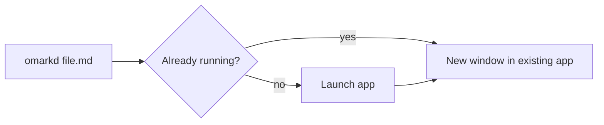

# Omarkd Showcase :rocket:

Everything Omarkd renders, in one file. Edit and save it — the window live-reloads.

## Text

**Bold**, *italic*, ~~strikethrough~~, `inline code`, ^superscript^, and an autolink: https://tauri.app.
Emoji shortcodes :tada: :sparkles: :+1: and footnotes[^speed].

[^speed]: Parsing and highlighting happen natively in Rust.

> [!NOTE]
> GitHub-style alerts are supported.

> [!WARNING]
> So are warnings, tips, important and caution blocks.

## Lists

- [x] Task lists
- [ ] Unfinished task
  1. Nested
  2. Ordered

Term
: Description lists work too.

## Code

```rust
use std::collections::HashMap;

fn main() {
    let mut counts: HashMap<&str, usize> = HashMap::new();
    for word in "the quick brown the lazy the".split_whitespace() {
        *counts.entry(word).or_default() += 1;
    }
    println!("{counts:?}");
}
```

```typescript
export const greet = (name: string): string => `Hello, ${name}!`;
```

```python
def fib(n: int) -> int:
    return n if n < 2 else fib(n - 1) + fib(n - 2)
```

## Math (native MathML)

Inline: $e^{i\pi} + 1 = 0$ and $\sum_{k=1}^{n} k = \frac{n(n+1)}{2}$.

$$
\int_{-\infty}^{\infty} e^{-x^2}\,dx = \sqrt{\pi}
$$

```math
\begin{bmatrix} a & b \\ c & d \end{bmatrix}^{-1} = \frac{1}{ad-bc}\begin{bmatrix} d & -b \\ -c & a \end{bmatrix}
```

## Diagrams



## Tables

| Feature | Engine | Where |
|:--|:--:|--:|
| Markdown | comrak | Rust |
| Highlighting | syntect | Rust |
| Math | Temml → MathML | WebView |
| Diagrams | Mermaid (lazy) | WebView |

## HTML

<details>
<summary>Embedded HTML is allowed (sanitized)</summary>

Hidden content. <kbd>⌘</kbd> + <kbd>O</kbd> opens a file.
</details>

## Links

- [Jump to Code](#code)
- [Another document](./second.md)
